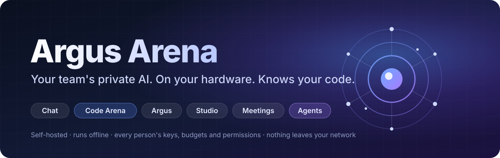
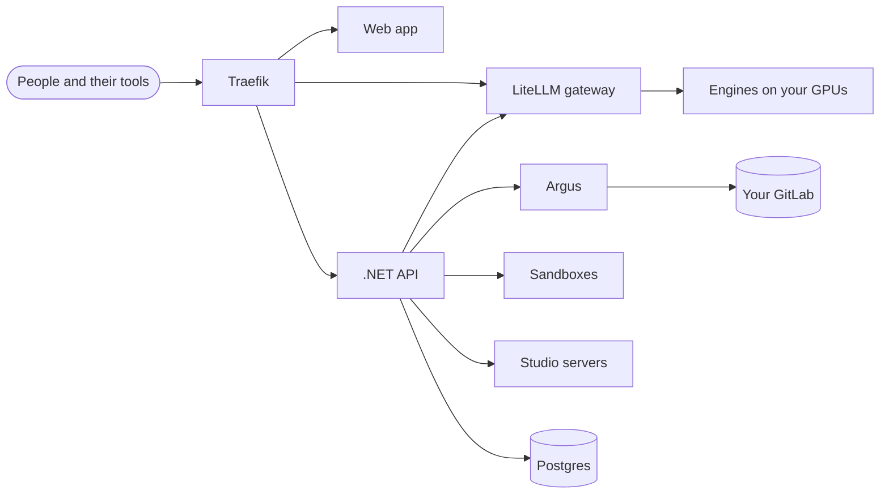

<p align="center">
  
</p>

<p align="center">
  <b>The AI platform for teams that can't send their work to someone else's cloud.</b><br>
  A chat that does real work, a coding agent with its own IDE, a studio, meetings and agents,
  running on your GPUs, inside your network, grounded in your own codebase.
</p>

<p align="center">
  <a href="#quick-start">Quick start</a> ·
  <a href="#code-arena">Code Arena</a> ·
  <a href="#argus">Argus</a> ·
  <a href="docs/README.md">Documentation</a> ·
  <a href="CHANGELOG.md">What's new</a>
</p>

<p align="center">
  
  
  
  
</p>

---

Most teams end up with a chat subscription, a coding assistant, an image tool, a
meeting bot and a few scripts in between. Every one of them is another account,
another bill, and another place your code and conversations go.

**Argus Arena is all of it in one stack you run yourself.** One sign-in, one set of
permissions, one budget per person, and models you choose, on hardware you own.
Nothing leaves your network, and it installs on a machine that never touches the
internet.

## What's inside

<table>
<tr>
<td width="50%" valign="top">

### 💬 A chat that does the work
Your models, with thinking levels, branches and files. Tools run on the
server: Python in a sandbox, the web you allow, your code through Argus. Pages,
diagrams and React components it writes run live beside the answer. Rooms bring
people in, with calls captioned live in each reader's language.

</td>
<td width="50%" valign="top">

### 🧑‍💻 Code Arena
Our own coding agent, with a full IDE in your browser: editor, search, git,
terminals, a debugger and language servers, tabs, breadcrumbs and an Outline
as in VS Code, and a code index that finds code by what it does or by name.
It's one file, installed in one line from your Arena and kept current by it.
Every Arena tool works as you, and every session is synced with the web chat.

</td>
</tr>
<tr>
<td valign="top">

### 🔎 Argus, your code's index
It mirrors your GitLab: symbols, references, issues, wikis and documentation
packs. It answers over MCP, and each developer sees **exactly** what their own
GitLab account can read, enforced in SQL.

</td>
<td valign="top">

### 🧠 Memory that lasts
One memory for the chat and Code Arena. It recalls by meaning, forms memories
from quiet chats, and tidies itself with undo. Chats thousands of messages long
still find what was said at the start, past work is found by what it was about,
and a project keeps its long memory in `.remember/`.

</td>
</tr>
<tr>
<td valign="top">

### 🎨 Studio
Pictures, edits with a brush, video, voices, music, background removal, vector
art with named parts that animate, and 3D models ready to print. They run on the
same GPUs, with the same rights and budgets as the chat.

</td>
<td valign="top">

### 🤖 Agents and apps
Build agents in Agent Studio that react to GitLab and act on it, turn a chat
into an app, ask questions of your databases and files, search a wiki of
everything the company knows, make a deck, let a browser agent do a task while
you watch, and sketch a screen that becomes working code. For long work the chat proposes a plan you
approve, and calls its tools from a short program when one call is not enough.

</td>
</tr>
<tr>
<td valign="top">

### 🎙️ Meetings
Record one in the browser or upload it. You get who said what, the minutes, and
action items given to people and reminded on their day.

</td>
<td valign="top">

### 🔬 Science lab
Mathematics, physics, chemistry, statistics, biology and quantum computing,
worked with tools that check each step: SymPy, units, RDKit, Biopython, Lean
with Mathlib for proofs, and Qiskit, Stim, QuTiP, PennyLane and PySCF on
simulators. Each problem is kept as a notebook of its cells, verdicts and
charts.

</td>
</tr>
<tr>
<td valign="top">

### 🔐 Security reviews
A repository read for weaknesses as you: each one quotes its line, names its
CWE and traces the data to it, grounded in CWE, OWASP and CodeQL's guidance,
with scanners beside the model. Its packages are matched against GitHub's
advisories, renewed every day, and **Fix it** writes a test and the fix and
opens the merge request as you.

</td>
<td valign="top">

### 📋 GRC and certifications
Fourteen frameworks with every clause mapped: ISO 27001, 42001 and 22301, SOC
2, PCI DSS, NIST's CSF, 800-53 and 800-171, the AI RMF and the EU AI Act. A
risk register, Statements of Applicability, policies, audits, suppliers and
AI systems, and how ready you are for each certification.

</td>
</tr>
<tr>
<td colspan="2" valign="top">

### 🛡️ Yours to run
SSO, LDAP and two-factor sign-in; API keys of one's own, each with its limits
and budget; groups decide models and tools, and a fair line keeps everyone
moving when it is busy. An audit log nobody changes unseen, a prompt log
behind its own permission, live checks of every control and the evidence in
one download. A dashboard for each role, llama.cpp, vLLM or SGLang as the
engine, an installer for offline hosts in one file that installs only the
features you choose, and a Helm chart for Kubernetes that rolls without a gap
and grows with its load.

</td>
</tr>
</table>

## Argus

A local model can't know a driver's IRQL or which header really declares
`CreateFileW`. Those facts are too specialised to live in any model's weights.
Argus hands the model the source and the real documentation, and the answers
change:

| model | alone | with Argus |
|---|:---:|:---:|
| `qwen3.6:27b` (dense, 27.8B) | 5 / 10 | **10 / 10** |
| `qwen3.6:35b` (MoE, 36.0B) | 5 / 10 | **9 / 10** |
| `qwen3.8:27b` (dense, 27.3B) | 5 / 9 | **9 / 10** |

Ten task families were graded against facts checked before any model ran. All
three models failed the same five tasks alone. Scale didn't fix that; retrieval
did, and the median answer got faster too (5.5 s to 2.4 s).
[The full comparison →](docs/measurements/model-comparison.md)

## Code Arena

```bash
curl -fsSL https://your-arena/api/downloads/code-arena/install.sh | sh
code-arena login --url https://your-arena
cd your-project && code-arena
```

That opens an IDE around the agent in your browser, served from your own
machine. Prefer the terminal? Use `code-arena chat`. Long sessions don't lose
the thread: big results are set aside, older ones are cleared before anything
is summarized, and the agent can read every earlier message back by number.
For long work it plans first: you approve the plan, each step is grounded in
the code and done only once its check passes, a step can be undone, and the
next session carries a half-done plan on. Steps that wait for nothing run at
once, and a short Python program can call its tools many times in one go.
Windows users run `irm https://your-arena/api/downloads/code-arena/install.ps1 | iex`.
[Everything Code Arena does →](docs/code-arena.md)

## How it compares

| | Argus Arena | Cloud AI assistants | A do-it-yourself stack |
|---|:---:|:---:|:---:|
| Code and conversations stay on your network | ✅ | ❌ | ✅ |
| Knows your codebase, within each person's GitLab rights | ✅ | some, through their cloud | you build it |
| Chat, coding agent, studio, meetings and agents in one sign-in | ✅ | several subscriptions | several projects to glue together |
| A key, a budget and model rights for each person | ✅ | per seat | ❌ |
| Any open model, on your own GPUs | ✅ | ❌ | ✅ |
| Installs on a host with no internet | ✅ | ❌ | rarely |
| Controls and evidence for ISO 27001, SOC 2, HIPAA and the GDPR | ✅ | their own, not yours | you build it |

## Quick start

On a Linux host with Docker (or rootless Podman) and an NVIDIA GPU:

```bash
git clone https://github.com/Binchitects/argus && cd argus/deploy
cp .env.example .env      # your domain, the models folder, the first model, six secrets
docker compose up -d
```

Open `https://llm.localhost` and sign in as `admin` with the password from
`.env`. The app fetches its first model and the media models on its own. For an
offline host, one `.run` file carries everything. The
[deployment guide](docs/deployment.md) covers Podman, GPUs across servers and
upgrades. For a large team or for availability, `./arenactl kube install`
checks a cluster first and installs the
[Helm chart](docs/deployment.md#helm). **Argus alone**, without the platform, is in
[deploy/argus-standalone/](deploy/argus-standalone/README.md).

## Under the hood



A .NET 10 API and a React app. llama.cpp and vLLM serve the models behind a
LiteLLM gateway, and Prometheus, Loki and Alertmanager watch it all.
[The architecture →](docs/architecture.md)

## Learn more

[Documentation](docs/README.md) · [The chat](docs/chat.md) ·
[Administration](docs/admin.md) · [Deployment](docs/deployment.md) ·
[Argus](docs/argus/README.md) · [Compliance](docs/compliance/README.md) ·
[Development](docs/development.md) ·
[The plan](docs/plan.md)

**Contributing:** see [CONTRIBUTING.md](CONTRIBUTING.md). **Security reports:** see
[SECURITY.md](SECURITY.md).

**Licence:** dual-licensed, under the **GNU AGPL v3** ([LICENSE.md](LICENSE.md))
or a **commercial license** from Binchitects for uses the AGPL doesn't fit.
[LICENSING.md](LICENSING.md) says which you need. Knowledge packs keep their own
upstream licences.
